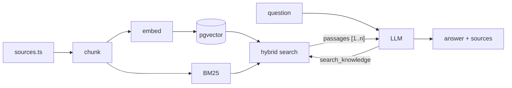

# RAG in the TuraKGL assistant

The assistant answers two kinds of questions:

- "Find me a 2-bedroom in Kicukiro under 300k" → `search_properties` (live listings)
- "How many contacts can I unlock for free?" → `search_knowledge` (RAG over help, terms and privacy)

For the second kind the model has to cite the passages it used, and say it doesn't know if nothing relevant comes back.

## Pipeline

- **Source text** – `src/lib/knowledge/sources.ts`. The /help, /terms and /privacy pages read from the same file.
- **Chunking** – one chunk per section, prefixed with its titles. Long sections are split by sentence (700 chars, 1-sentence overlap).
- **Ingestion** – `npm run knowledge:ingest`. Uses a content hash so only changed chunks get re-embedded.
- **Storage** – `supabase-knowledge-rag.sql`: `knowledge_chunks` table, HNSW index, `match_knowledge()` with a 0.3 similarity floor. Server-only access.
- **Retrieval** – pgvector + BM25, merged with reciprocal rank fusion. Falls back to BM25 if pgvector fails.
- **Answering** – `src/app/api/agents/chat/route.ts`. Retrieved text is treated as data, not instructions.

## Evaluation

`npm run knowledge:eval` – 18 test questions (2 with no answer in the docs).

BM25 only, k = 4:

| Metric | Result |
| --- | --- |
| Hit rate @4 | 93.8% (15/16) |
| MRR | 0.865 |
| No-answer questions that still got passages | 1/2 |

The miss is a paraphrase and the false positive matched on "Kigali" – both cases the vector search is meant to fix. Run `npm run knowledge:eval -- --hybrid` once Supabase is set up.

## Tests

`npm test` – chunking, BM25, fusion, fallback, citations, and the chat route with OpenAI/Supabase mocked.
