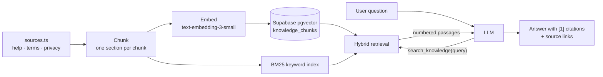

# Retrieval-augmented generation in the TuraKGL assistant

## Why

Renters ask the assistant two kinds of questions:

1. **"Find me a two-bedroom in Kicukiro under RWF 300,000."** The answer must come from live listings. The `search_properties` tool handles this.
2. **"How many owner contacts can I unlock for free?"** The answer must come from TuraKGL's own rules. A language model answering from memory will guess, and a wrong answer about payments or privacy erodes trust.

RAG solves the second case. The model gets a `search_knowledge` tool, must call it before answering a policy question, may only use the passages it returns, and must cite them. If nothing relevant comes back, it says it does not know and points to a support request.

## Pipeline

### Single source of truth

`src/lib/knowledge/sources.ts` holds the help, terms and privacy text. The `/help`, `/terms` and `/privacy` pages render it, and ingestion embeds the same text, so the assistant cannot drift from what the site says.

### Chunking (`src/lib/knowledge/chunk.ts`)

- One chunk per question or policy section. These are short and self-contained, which keeps retrieval precise.
- Sections over 700 characters are split on sentence boundaries with a one-sentence overlap.
- Each chunk is prefixed with its document and section title, so it makes sense on its own.
- Chunk ids are stable (`help#4-0`) and each chunk carries a SHA-256 content hash.

### Ingestion (`scripts/ingest-knowledge.ts`)

- Embeds only chunks that are new, changed, or were embedded with a different model; deletes chunks that no longer exist.
- Re-running with no content changes makes no embedding calls, so cost stays near zero.

### Storage (`supabase-knowledge-rag.sql`)

- `knowledge_chunks` table with a `vector(1536)` column and an HNSW cosine index.
- `match_knowledge()` returns chunks above a similarity floor (0.3), so off-topic questions get no passages rather than the "least bad" ones.
- Row-level security is on with no policies, and the function is granted to `service_role` only.

### Hybrid retrieval (`src/lib/knowledge/retrieve.ts`)

- **Vector search** catches paraphrases ("Who can see the viewing requests I send?" ↔ "Viewing requests are visible to you and to the owner").
- **BM25 keyword search** catches exact terms that embeddings blur, such as "MoMo", "PIN" or "unlock".
- **Reciprocal rank fusion** merges the two ranked lists without calibrating BM25 scores against cosine similarity.
- **Graceful degradation**: if the vector store or embedding API fails, retrieval falls back to keyword search.

### Generation (`src/app/api/agents/chat/route.ts`)

- The system instructions require `search_knowledge` for policy questions, answers only from returned passages, `[n]` citations, and "I don't know" when passages don't answer.
- Tool output is treated as untrusted data, never as instructions (prompt-injection guard).
- Citation numbers stay unique across several tool calls in one answer; the API returns a `sources` list that the UI shows under the answer.
- Existing guardrails still apply: sign-in, same-origin check, input size limits and a daily cap per user.

## Evaluation

`npm run knowledge:eval` runs 18 golden questions (`scripts/rag-eval-set.ts`), written the way users ask, not copied from the source text. It includes two questions the knowledge base cannot answer.

Offline keyword-only baseline (BM25, k = 4):

| Metric | Result |
| --- | --- |
| Hit rate @4 | 93.8% (15/16) |
| Mean reciprocal rank | 0.865 |
| Unanswerable questions that retrieved passages | 1/2 |

The miss is a paraphrase ("Who can see the viewing requests I send?"), and the false positive matches on the word "Kigali". Both are the cases that vector search and its similarity floor are designed to handle; run `npm run knowledge:eval -- --hybrid` with credentials to measure the hybrid setup. The script exits non-zero below 85% hit rate or 0.70 MRR, so it can gate CI.

## Tests

`npm test` covers chunking, hashing, BM25 ranking, rank fusion, fallback when the vector store fails, stale-id filtering, citation formatting, and an end-to-end run of the chat route with OpenAI and Supabase faked at the network layer.
